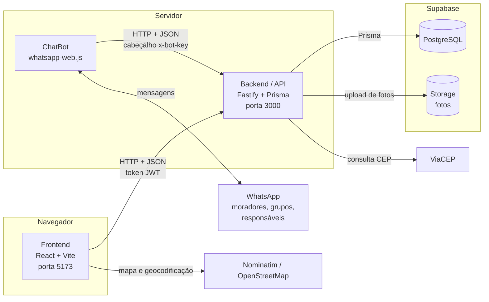
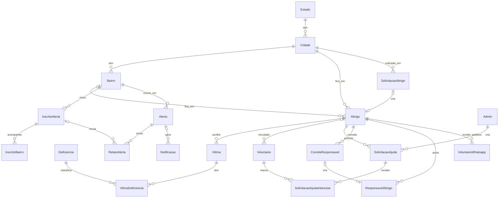
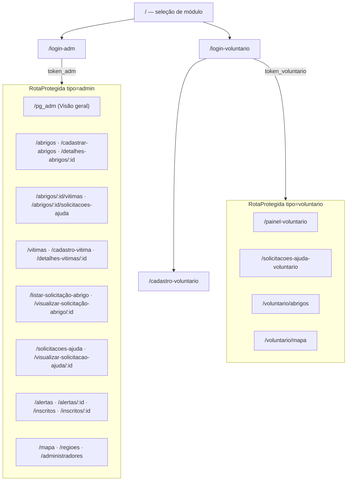
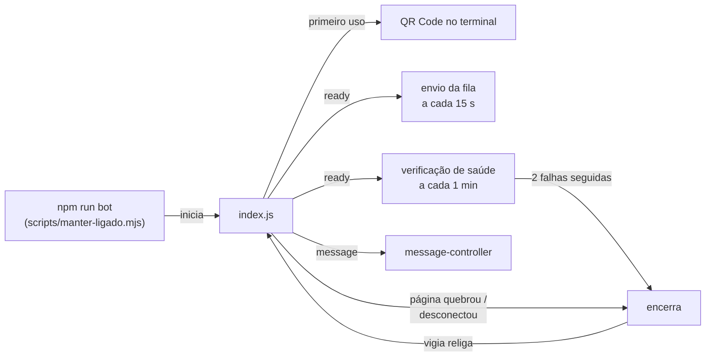
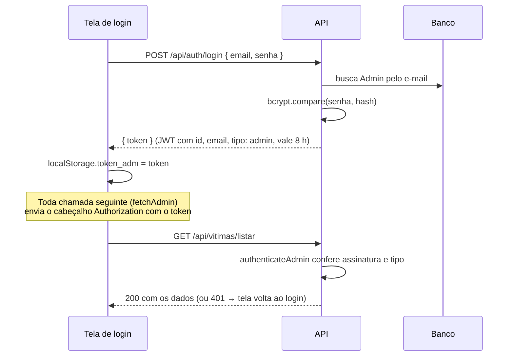
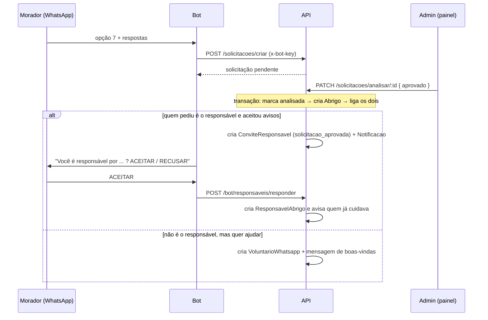
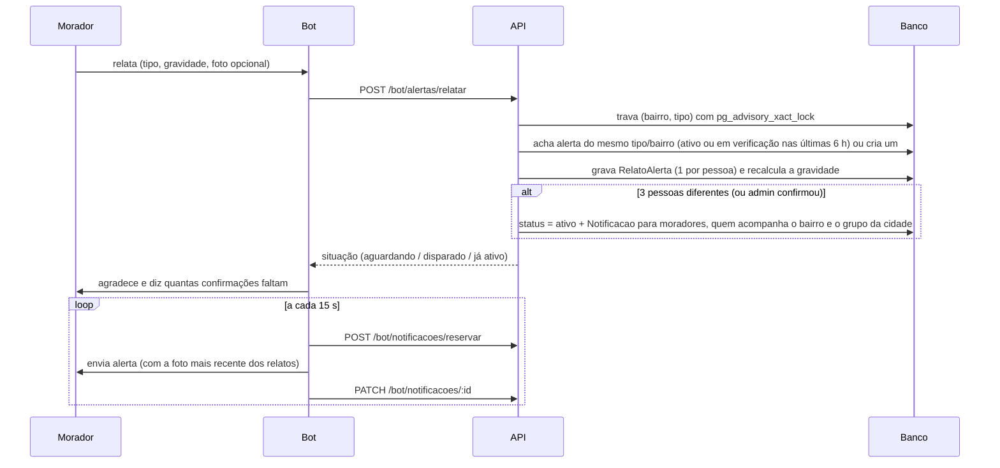

# S.O.S Vale — Documentação técnica

Este documento explica **como o S.O.S Vale funciona por dentro**: as partes do sistema, as tecnologias e bibliotecas, o banco de dados, todas as rotas da API, as telas do painel, o bot de WhatsApp e o caminho que os dados percorrem em cada funcionalidade.

> Para instalar e rodar o projeto, veja o [`README.md`](../README.md). Para as convenções de código usadas no dia a dia, veja o [`CLAUDE.md`](../CLAUDE.md).

---

## Sumário

1. [Visão geral](#1-visão-geral)
2. [Arquitetura](#2-arquitetura)
3. [Tecnologias e bibliotecas](#3-tecnologias-e-bibliotecas)
4. [Estrutura de pastas](#4-estrutura-de-pastas)
5. [Banco de dados](#5-banco-de-dados)
6. [Backend (API)](#6-backend-api)
7. [Rotas da API](#7-rotas-da-api)
8. [Frontend (painel web)](#8-frontend-painel-web)
9. [Telas, uma a uma](#9-telas-uma-a-uma)
10. [ChatBot (WhatsApp)](#10-chatbot-whatsapp)
11. [Fluxos de dados de ponta a ponta](#11-fluxos-de-dados-de-ponta-a-ponta)
12. [Segurança e autenticação](#12-segurança-e-autenticação)
13. [Testes e scripts de apoio](#13-testes-e-scripts-de-apoio)
14. [Como estender o projeto](#14-como-estender-o-projeto)
15. [Limitações conhecidas](#15-limitações-conhecidas)
16. [Glossário](#16-glossário)

---

## 1. Visão geral

O S.O.S Vale é um protótipo acadêmico (Projeto Integrador I – Fatec) de apoio a vítimas de desastres naturais no **Vale do Paraíba** (Taubaté, Caçapava e Pindamonhangaba). Ele resolve três problemas:

| Problema | Como o sistema resolve |
|---|---|
| Ninguém sabe ao certo quais abrigos existem, quantas vagas têm e o que precisam | Cadastro de **abrigos** com ocupação, estrutura e **pedidos de ajuda** |
| Pessoas acolhidas ficam sem registro (quem está onde, quem precisa de acessibilidade) | Cadastro de **vítimas**, com vínculo ao abrigo e deficiências |
| Avisos de alagamento, deslizamento etc. chegam tarde ou são boatos | **Alertas** relatados pelos moradores no WhatsApp, que só disparam quando várias pessoas confirmam |

Há três tipos de usuário:

- **Administrador** (equipe de gestão / Defesa Civil): usa o painel web completo.
- **Voluntário**: usa um painel web reduzido (pedidos de ajuda, abrigos, mapa).
- **Morador / população**: conversa com o **bot de WhatsApp**, sem precisar instalar nada.

---

## 2. Arquitetura

O projeto tem **três programas independentes**, cada um na sua pasta e com seu próprio `package.json`:



Regras importantes da arquitetura:

- **Só a API fala com o banco.** O painel e o bot nunca acessam o PostgreSQL diretamente; eles chamam a API.
- **O bot é um cliente da API como o painel**, só que se identifica com uma chave (`x-bot-key`) em vez de login.
- **A API não manda mensagens de WhatsApp.** Ela grava as mensagens numa **fila** (tabela `Notificacao`), e o bot busca essa fila de tempos em tempos e envia. Assim, se o bot estiver desligado, nada se perde: as mensagens esperam na fila.
- **Fotos** chegam à API em base64 (texto) dentro do JSON e são guardadas no **Supabase Storage**. No banco fica só a URL pública da foto.

---

## 3. Tecnologias e bibliotecas

### 3.1 Linguagem e padrão

- **JavaScript** em tudo, no formato **ES Modules** (`import` / `export`, `"type": "module"` no `package.json`). Não há TypeScript, exceto o `Backend/prisma/seed.ts`.
- **Node.js** roda a API e o bot. O painel roda no navegador.

### 3.2 Backend (`Backend/`)

| Biblioteca | Para que serve no projeto |
|---|---|
| **Fastify 5** | Servidor HTTP da API. Cada arquivo de `routes/` é um *plugin* do Fastify registrado com um prefixo (`/api/abrigos`, `/api/vitimas`…). É rápido e tem *hooks* (`onRequest`) usados para exigir login. |
| **@fastify/cors** | Libera o painel (outra porta, 5173) para chamar a API (porta 3000). Sem isso o navegador bloquearia as requisições. |
| **@fastify/jwt** | Cria e confere os **tokens JWT** do login. O token guarda `id`, `email` e `tipo` (`admin` ou `voluntario`) e vale 8 horas. |
| **Prisma 6** (`prisma` + `@prisma/client`) | ORM: traduz código JavaScript em SQL. O arquivo `prisma/schema.prisma` descreve todas as tabelas; `prisma migrate` cria as tabelas no banco; `prisma generate` gera o cliente usado nas rotas (`prisma.abrigo.findMany(...)`). |
| **PostgreSQL (Supabase)** | Banco de dados relacional, hospedado no Supabase. |
| **@supabase/supabase-js** | Cliente do Supabase, usado só para o **Storage** (upload e remoção de fotos nos *buckets* `fotos-abrigo`, `fotos-vitima` e `fotos-alerta`). |
| **bcrypt** | Criptografa as senhas de admin e voluntário (custo 10). O banco nunca guarda a senha em texto. |
| **dotenv** | Lê o arquivo `.env` e coloca as variáveis em `process.env`. |
| **node:crypto** (nativo) | `timingSafeEqual` compara a chave do bot sem vazar informação pelo tempo de resposta; `randomInt` e `sha256` geram e guardam (como *hash*) o código de 6 dígitos do convite de responsável. |
| **tsx** | Roda o `seed.ts` (TypeScript) sem precisar compilar. |
| **concurrently** | Roda API e painel juntos no `npm run dev`. |
| **@electric-sql/pglite** + **pglite-socket** | PostgreSQL **em memória**, usado só nos testes (`npm run banco:teste`). Nada vai para o Supabase. |

Serviços externos usados pela API: **ViaCEP** (`viacep.com.br`), que transforma um CEP em rua, bairro e cidade.

### 3.3 Frontend (`Frontend/`)

| Biblioteca | Para que serve no projeto |
|---|---|
| **React 19** | Biblioteca de interface. Cada tela é um componente (função) que guarda seu estado com `useState` e busca dados com `useEffect`. |
| **Vite 8** | Servidor de desenvolvimento (recarrega a tela ao salvar o arquivo) e empacotador para produção (`npm run build`). Também lê `VITE_API_URL` do `.env`. |
| **React Router 7** (`react-router-dom`) | Navegação entre telas sem recarregar a página. As rotas ficam em `App.jsx`. `useParams` lê o `:id` da URL e `useNavigate` muda de tela. |
| **Leaflet** + **React-Leaflet** | Mapa interativo (tela Mapa): camadas de mapa do OpenStreetMap, marcadores de abrigo e círculos de alerta. |
| **react-icons** (`react-icons/lu`) | Ícones da coleção Lucide, usados em todas as telas (o projeto não usa emojis no painel). |
| **ESLint** | Confere o código (`npm run lint`), incluindo as regras dos *hooks* do React. |

Serviço externo usado pelo navegador: **Nominatim** (OpenStreetMap), que transforma um endereço em latitude/longitude quando o abrigo não tem coordenadas salvas. Ele permite no máximo 1 consulta por segundo, e a tela respeita isso.

Fontes: **Lexend** (títulos e números) e **Figtree** (texto).

### 3.4 ChatBot (`ChatBot/`)

| Biblioteca | Para que serve no projeto |
|---|---|
| **whatsapp-web.js 1.34.7** | Controla um WhatsApp Web de verdade dentro de um Chrome invisível (Puppeteer). Recebe mensagens (`client.on('message')`) e envia texto e fotos. A sessão fica salva em `.wwebjs_auth/` (estratégia `LocalAuth`), então o QR Code só é lido uma vez. |
| **qrcode-terminal** | Desenha o QR Code de login no terminal. |
| **dotenv** | Lê `BOT_API_KEY` e `API_URL` do `.env`. |
| **node-forge** | Dependência auxiliar de criptografia. |
| **fetch** (nativo do Node) | Chamadas HTTP do bot para a API (`services/api.js`). |

Observação: a versão 1.34.7 tem um bug no envio de foto desde uma atualização do WhatsApp Web. O script `scripts/corrigir-wwebjs-midia.cjs` roda sozinho no `npm install` (`postinstall`) e corrige o arquivo dentro de `node_modules`.

---

## 4. Estrutura de pastas

```
Projeto-Integrador-I/
├── Backend/
│   ├── prisma/
│   │   ├── schema.prisma        ← fonte de verdade do banco (todas as tabelas)
│   │   ├── migrations/          ← histórico de alterações do banco (SQL)
│   │   └── seed.ts              ← cadastra os tipos de deficiência
│   ├── scripts/                 ← banco de teste, API de teste, backup, demonstração
│   ├── src/
│   │   ├── server.js            ← liga a API: CORS, JWT, autenticadores, rotas
│   │   ├── supabase.js          ← cliente do Storage
│   │   ├── lib/                 ← regras compartilhadas entre rotas
│   │   └── routes/              ← um arquivo por assunto (plugin Fastify)
│   ├── testes/api.teste.mjs     ← verificações automáticas da API
│   └── route.http               ← exemplos de requisição (extensão REST Client)
├── Frontend/
│   └── src/
│       ├── App.jsx              ← todas as rotas de tela
│       ├── components/          ← peças reutilizáveis (sidebar, seletores…)
│       ├── pages/               ← uma pasta por tela (index.jsx + CSS)
│       ├── services/            ← funções que chamam a API
│       ├── styles/sosvale-glass.css ← tema visual ("vidro")
│       └── utils/               ← limites e máscaras, rótulos, filtros
├── ChatBot/
│   ├── index.js                 ← liga o WhatsApp e recebe as mensagens
│   ├── controllers/             ← fluxos de conversa
│   ├── services/                ← cliente da API, fila de envio, fotos, telefone
│   ├── state/state.js           ← em que etapa cada conversa está
│   ├── utils/formato.js         ← padrão visual das mensagens
│   ├── scripts/                 ← vigia que religa o bot, correção do wwebjs
│   └── testes/                  ← simulação de conversas
└── Documentações/               ← visão de projeto, atas, sprints, guias
```

---

## 5. Banco de dados

O banco é PostgreSQL e é descrito no `Backend/prisma/schema.prisma`. Cada `model` vira uma tabela.

### 5.1 Mapa das tabelas



### 5.2 As tabelas, por grupo

**Pessoas que usam o painel**

| Tabela | O que guarda |
|---|---|
| `Admin` | Administradores: nome, e-mail (único), senha criptografada, cargo, órgão. |
| `Voluntario` | Voluntários do painel: dados pessoais, e-mail e senha, status e o abrigo em que atuam (`abrigoId`, opcional). |

**Regiões**

| Tabela | O que guarda |
|---|---|
| `Estado` | As 27 UFs (já vêm cadastradas pela migração). |
| `Cidade` | Nome, estado, `grupoWhatsappId` (grupo que recebe os alertas) e `grupoWhatsappLink` (convite do grupo, enviado pelo bot). |
| `Bairro` | Nome, cidade, população estimada, área e `nivelRisco` (`baixo`, `medio`, `alto`, `critico`). |

**Abrigos e pessoas acolhidas**

| Tabela | O que guarda |
|---|---|
| `Abrigo` | Nome, endereço, CEP, coordenadas, telefone, responsável, tipo, `capacidadeTotal`, `capacidadeOcupada`, estrutura (`possuiAtendimentoMedico`, `possuiEnfermagem`, `possuiPets`, `possuiAcessibilidade`, `possuiCozinha`), foto e status (`ativo`, `manutencao`, `desativado`). |
| `Vitima` | Pessoa acolhida: nome, CPF, telefone (único), nascimento, gênero, foto, abrigo atual e `dataEntrada` no abrigo. |
| `Deficiencia` | Tipos de deficiência (Física, Visual, TEA…), cadastrados pelo `npm run seed`. |
| `VitimaDeficiencia` | Ligação N:N entre vítima e deficiência (uma vítima pode ter várias). |
| `SolicitacaoAbrigo` | Local **indicado** para virar abrigo (pelo bot ou pelo site), com os dados de quem indicou. Fica `pendente` até o admin aprovar ou recusar; ao aprovar, vira um `Abrigo`. |

**Pedidos de ajuda**

| Tabela | O que guarda |
|---|---|
| `SolicitacaoAjuda` | Necessidade de um abrigo criada pelo admin: título, descrição, categoria (`doacao`, `medicamento`, `voluntariado`, `infraestrutura`, `outro`), urgência (`baixa` a `critica`), status (`aberto`, `em_andamento`, `concluido`, `cancelado`) e voluntário responsável. |
| `SolicitacaoAjudaInteresse` | Voluntário que clicou "tenho interesse" num pedido. |

**Alertas**

| Tabela | O que guarda |
|---|---|
| `InscritoAlerta` | Morador inscrito pelo bot: nome, e-mail, `whatsappId` (único), telefone, bairro onde mora, se está ativo. |
| `InscritoBairro` | Outros bairros que o morador acompanha (ex.: o bairro dos pais). |
| `Alerta` | Uma ocorrência num bairro: tipo (`alagamento`, `deslizamento`, `arvore_caida`, `falta_energia`, `incendio`, `via_interditada`, `vendaval`), gravidade, status (`em_verificacao` → `ativo` → `encerrado` ou `cancelado`). |
| `RelatoAlerta` | Cada relato de um morador sobre um alerta (gravidade e foto opcional). Uma pessoa só relata uma vez por alerta. |
| `Notificacao` | **Fila de mensagens de WhatsApp.** Cada linha é uma mensagem a enviar: destino, texto, foto, status (`pendente`, `enviando`, `enviada`, `falha`, `cancelada`) e tentativas. Serve para alertas, convites e avisos. |

**WhatsApp dos abrigos**

| Tabela | O que guarda |
|---|---|
| `ConviteResponsavel` | Convite para alguém ser responsável pelo abrigo no WhatsApp. Guarda **como o admin conferiu** a pessoa (`metodoConferencia`), a forma (mensagem ou código), o *hash* do código, validade (72 h) e status. |
| `ResponsavelAbrigo` | WhatsApp que recebe os avisos do abrigo. Só existe depois que a própria pessoa responde do número dela. |
| `VoluntarioWhatsapp` | Pessoa que se ofereceu pelo bot para ajudar um abrigo. Não tem conta no painel; recebe cada novo pedido de ajuda pelo WhatsApp. |

### 5.3 Convenções do banco

- Chaves primárias seguem `id_<entidade>` (`id_abrigo`, `id_vitima`…), **exceto** `Admin.id` e `SolicitacaoAjudaInteresse.id`.
- `Abrigo.capacidadeOcupada` é um **contador mantido pela API**: sobe ao vincular uma vítima e desce ao desvincular ou excluir.
- Para não quebrar as telas, a API devolve `cidade`, `estado` e `bairro` **como texto** junto do abrigo (função `achatarLocalizacao`), mesmo que no banco sejam chaves para outras tabelas.
- Toda mudança de tabela vira uma **migração** em `prisma/migrations/` (`npx prisma migrate dev --name <nome>`).

---

## 6. Backend (API)

### 6.1 Como a API liga (`src/server.js`)

1. Cria o Fastify com log ligado.
2. Registra o **CORS** (libera o painel).
3. Registra o **JWT** com a chave `JWT_SECRET` do `.env`.
4. Cria três **autenticadores**, usados pelas rotas:
   - `app.authenticate`: aceita qualquer token válido (admin ou voluntário).
   - `app.authenticateAdmin`: exige token com `tipo: 'admin'`. Sem token → 401; token de voluntário → 403.
   - `app.authenticateBot`: exige o cabeçalho `x-bot-key` igual ao `BOT_API_KEY`.
5. Define um **tratador de erros** geral: qualquer erro não tratado vira `{ mensagem: '...' }` em português (o Fastify responderia em inglês). Foto grande demais (413) vira "Envie uma foto de até 2 MB".
6. Registra as rotas com os prefixos e sobe na porta `PORT` (padrão 3000).

### 6.2 Anatomia de uma rota

Todas as rotas seguem o mesmo jeito. Exemplo simplificado:

```js
// Backend/src/routes/vitima.js
import prisma from '../lib/prisma.js'          // conexão única com o banco

export default async function vitimaRoutes(app) {
  app.addHook('onRequest', app.authenticateAdmin) // todas as rotas do arquivo exigem admin

  app.get('/listar/:id', async (request, reply) => {
    const vitima = await prisma.vitima.findUnique({ where: { id_vitima: Number(request.params.id) } })
    if (!vitima) return reply.status(404).send({ mensagem: 'Vítima não encontrada.' })
    return reply.status(200).send(vitima)
  })
}
```

Padrões que se repetem:

- **Verbos e caminhos:** `POST /cadastrar`, `GET /listar`, `GET /listar/:id`, `PUT /atualizar/:id`, `DELETE /excluir/:id`. Solicitação de abrigo usa `POST /criar` e `PATCH /analisar/:id`.
- **Erros:** sempre `{ mensagem: '...' }`, com o código certo (400 dado inválido, 401 sem login, 403 sem permissão, 404 não existe, 409 conflito como "abrigo lotado").
- **Validação antes do banco:** limites de tamanho, CPF, telefone e CEP são conferidos em `lib/validacao.js`; assim a API responde 400 com uma mensagem clara em vez de erro 500.
- **Transações** (`prisma.$transaction`) quando várias tabelas mudam juntas (ex.: mover vítima de abrigo mexe na vítima e na ocupação de dois abrigos). Se uma etapa falhar, nada é salvo.

### 6.3 Bibliotecas internas (`src/lib/`)

| Arquivo | O que faz |
|---|---|
| `prisma.js` | Cria **uma única** conexão com o banco, usada por todas as rotas. (Antes cada rota criava a sua e o Supabase recusava por excesso de conexões, erro `EMAXCONN`.) |
| `validacao.js` | Limites de caracteres (os mesmos de `Frontend/src/utils/campos.js`), leitura de datas (`AAAA-MM-DD` ou `DD/MM/AAAA`), CPF com dígito verificador, telefone com DDD, CEP, e-mail; limite de 4 MB para corpo com foto. |
| `localizacao.js` | `selectLocalizacao` + `achatarLocalizacao` (cidade/estado/bairro como texto), `consultarCep` (ViaCEP), `obterOuCriarBairroPorCep` (cria bairro e cidade que ainda não existem), `normalizarTexto` (compara sem acento). |
| `armazenamento.js` | `enviarFotoBase64` (sobe a foto no Storage com nome único) e `removerFotos`. |
| `alertas.js` | Toda a regra de alertas: tipos e gravidades, `registrarRelato`, `dispararAlerta`, `cancelarAlerta`, `encerrarAlerta` e os textos das mensagens. Detalhes na [seção 11.5](#115-alerta-do-relato-ao-whatsapp). |
| `inscritos.js` | Formato padrão dos moradores inscritos nas respostas. |
| `responsaveis.js` | Convites e vínculo dos responsáveis de abrigo: telefones (`chaveTelefone` compara DDD + 8 últimos dígitos, por causa do 9 que o WhatsApp às vezes omite), código de 6 dígitos (guardado só como *hash*), `criarConvite`, `aceitarConvite`, `avisarResponsaveis`, `veioDoBot`. |
| `voluntariosWhatsapp.js` | Voluntários do abrigo no WhatsApp: `adicionarVoluntario`, `avisarVoluntarios` (manda o novo pedido de ajuda) e os textos. |

### 6.4 Fotos

1. A tela lê o arquivo escolhido com `FileReader` e o transforma em **base64**.
2. O base64 vai no JSON (`fotoAbrigo`, `fotoVitima`).
3. A API cria o registro, sobe a foto no Storage com o nome `<entidade>-<id>-<data>.jpg` e salva a URL pública no registro.
4. O nome muda a cada envio para o navegador não mostrar a foto antiga guardada em cache.
5. Ao trocar ou remover a foto, a API apaga o arquivo antigo do Storage.

---

## 7. Rotas da API

Legenda da coluna **Acesso**: **Pública** (sem login) · **Admin** (token de admin) · **Logado** (qualquer token) · **Voluntário** (token de voluntário) · **Bot** (cabeçalho `x-bot-key`).

### 7.1 `/api/auth` — administradores

| Método e caminho | Acesso | O que faz |
|---|---|---|
| `POST /cadastrar` | Pública só para o **primeiro** admin; depois, Admin | Cria administrador (senha com bcrypt). |
| `GET /listar` | Admin | Lista os administradores. |
| `POST /login` | Pública | Confere e-mail e senha e devolve o **token** (8 h). |

### 7.2 `/api/abrigos`

| Método e caminho | Acesso | O que faz |
|---|---|---|
| `POST /cadastrar` | Admin | Cria abrigo (com foto opcional). |
| `GET /listar` | Pública | Lista abrigos com filtros (`cidadeId`, `bairroId`, `status`, `endereco`). Traz `nivelRisco` e `statusAlerta` (o bairro tem alerta ativo). Aberta de propósito: o bot e o voluntário usam; não traz vítimas. |
| `GET /listar/:id` | Admin | Detalhes completos, incluindo as vítimas abrigadas. |
| `PUT /atualizar/:id` | Admin | Edita dados e foto. |
| `DELETE /excluir/:id` | Admin | Exclui o abrigo. |

### 7.3 Regiões: `/api/estados`, `/api/cidades`, `/api/bairros`

| Método e caminho | Acesso | O que faz |
|---|---|---|
| `GET /estados/listar` | Pública | As 27 UFs. |
| `GET /cidades/listar`, `GET /cidades/listar/:id` | Pública | Cidades (com estado e grupo do WhatsApp). |
| `POST /cidades/cadastrar`, `PUT /cidades/atualizar/:id`, `DELETE /cidades/excluir/:id` | Admin | Gestão de cidades (inclui o link do grupo de alertas). |
| `GET /bairros/listar` (`?cidadeId=`, `?nome=`), `GET /bairros/listar/:id` | Pública | Bairros. |
| `GET /bairros/cep/:cep` | Pública | Consulta o ViaCEP e diz se cidade e bairro já existem. **Não cria nada.** |
| `POST /bairros/cep` | Admin | Cria o bairro (e a cidade) do CEP, se ainda não existirem. |
| `POST /bairros/cadastrar`, `PUT /bairros/atualizar/:id` | Admin | Gestão de bairros (nível de risco, população, área). |
| `DELETE /bairros/excluir/:id` | Admin | Exclui, **bloqueando** se houver abrigos, moradores ou alertas no bairro. |

### 7.4 `/api/vitimas` (todas exigem Admin — dados pessoais, LGPD)

| Método e caminho | O que faz |
|---|---|
| `POST /cadastrar` | Cria vítima (foto, abrigo e `deficienciaIds` opcionais). Se vier abrigo, confere se há vaga e soma 1 na ocupação. |
| `GET /listar` (`?nome=`, `?abrigoId=`) | Lista com abrigo e deficiências (usado pelos filtros do Hub de Vítimas). |
| `GET /deficiencias` | Tipos de deficiência `[{ id, nome }]`, para montar as opções nas telas. |
| `GET /listar/:id` | Detalhes, com o abrigo (endereço, telefone) e as deficiências em ordem alfabética. |
| `PUT /atualizar/:id` | Edita qualquer campo enviado (o que não vier fica como está). Trocar de abrigo, mexer na ocupação e trocar as deficiências acontece numa **transação**; abrigo lotado → 409. |
| `DELETE /excluir/:id` | Exclui a vítima, suas deficiências e libera a vaga, numa transação; depois apaga a foto. |

### 7.5 `/api/solicitacoes` — indicação de local para abrigo

| Método e caminho | Acesso | O que faz |
|---|---|---|
| `POST /criar` | Pública | Registra a indicação. Os campos do WhatsApp (`solicitanteWhatsappId`, `solicitanteEhResponsavel`, `aceitaAvisosWhatsapp`, `querVoluntariar`) só são aceitos se o pedido vier do bot (`veioDoBot`). |
| `GET /listar` (`?status=`), `GET /listar/:id` | Admin | Lista e detalhes. |
| `PATCH /analisar/:id` | Admin | Aprova (cria o `Abrigo`) ou recusa (exige motivo). Ver [seção 11.4](#114-indicação-de-abrigo-pelo-bot-até-virar-abrigo). |
| `DELETE /excluir/:id` | Admin | Exclui a solicitação. |

### 7.6 `/api/voluntarios`

| Método e caminho | Acesso | O que faz |
|---|---|---|
| `POST /cadastrar` | Pública | Cadastro do voluntário (tela pública). |
| `POST /login` | Pública | Devolve o token de voluntário (8 h). |
| `GET /me` | Logado | Dados do voluntário logado (o id vem do token). |
| `PATCH /me/abrigo` | Logado | Vincula ou desvincula o voluntário logado a um abrigo. |
| `GET /listar`, `GET /listar/:id`, `PUT /atualizar/:id`, `DELETE /excluir/:id` | Admin | Gestão dos voluntários. |

### 7.7 `/api/solicitacoes-ajuda` — pedidos de ajuda dos abrigos

| Método e caminho | Acesso | O que faz |
|---|---|---|
| `POST /cadastrar` | Admin | Cria pedido para um abrigo (quem criou vem do token). Avisa os voluntários do abrigo no WhatsApp. |
| `GET /listar` (`abrigoId`, `status`, `categoria`, `urgencia`) | Admin | Todos os pedidos, com contato dos interessados. |
| `GET /abrigo/:id` | Admin | Pedidos de um abrigo. |
| `GET /publico` | Pública | Só pedidos abertos/em andamento + contato do abrigo (nada pessoal). Usado pelo voluntário. |
| `GET /listar/:id` | Admin | Detalhes com voluntários interessados. |
| `PUT /atualizar/:id` | Admin | Edita, muda status, define voluntário responsável, observação de fechamento. |
| `GET /meus-interesses` | Voluntário | IDs dos pedidos em que o voluntário logado marcou interesse. |
| `POST /interesse/:id`, `DELETE /interesse/:id` | Voluntário | Marca / desmarca interesse. Ao marcar, os responsáveis do abrigo são avisados no WhatsApp. |
| `DELETE /excluir/:id` | Admin | Exclui o pedido. |

### 7.8 `/api/alertas` (Admin) e `/api/mapa` (Logado)

| Método e caminho | O que faz |
|---|---|
| `GET /alertas/opcoes` | Tipos, gravidades e configuração (para filtros e rótulos). |
| `GET /alertas/listar` (`status`, `tipo`, `cidadeId`, `bairroId`) | Lista alertas. |
| `GET /alertas/listar/:id` | Alerta + relatos (quem, gravidade, foto) + situação das notificações. |
| `PATCH /alertas/confirmar/:id` | Admin confirma e **dispara agora**, sem esperar os relatos. |
| `PATCH /alertas/cancelar/:id` | Cancela (exige motivo). Se já tinha disparado, manda **correção** a quem recebeu. |
| `PATCH /alertas/encerrar/:id` | Ocorrência resolvida. |
| `PATCH /alertas/reenviar-falhas/:id` | Volta para a fila as mensagens que falharam. |
| `DELETE /alertas/excluir/:id` | Apaga alerta, relatos, notificações e fotos. |
| `GET /mapa/alertas` | Só alertas **ativos**, com bairro e cidade, para os círculos do mapa. |

### 7.9 `/api/inscritos` (Admin)

`GET /listar`, `GET /listar/:id`, `PUT /atualizar/:id`, `DELETE /excluir/:id` — gestão dos moradores inscritos nos alertas.

### 7.10 `/api/responsaveis` (Admin)

| Método e caminho | O que faz |
|---|---|
| `GET /listar?abrigoId=` | Responsáveis, convites e voluntários do abrigo no WhatsApp. |
| `POST /convidar` | Cria convite: `{ abrigoId, nome, telefone?, forma: 'mensagem' \| 'link', metodoConferencia, observacao? }`. Por **mensagem**, o bot pergunta ao celular; por **link**, devolve um código para o admin repassar. |
| `PATCH /convites/cancelar/:id` | Cancela convite sem resposta. |
| `PATCH /desativar/:id` | Desvincula responsável (ele recebe uma mensagem avisando). |
| `PATCH /voluntarios/desativar/:id` | Tira um voluntário do WhatsApp da lista do abrigo. |

### 7.11 `/api/bot` (só o ChatBot, cabeçalho `x-bot-key`)

| Método e caminho | O que faz |
|---|---|
| `GET /inscritos/:whatsappId` | Busca o morador pelo WhatsApp. |
| `POST /inscritos` | Inscreve (ou reativa) o morador: `{ whatsappId, telefone?, nome, email, bairroId }`. |
| `POST /inscritos/:whatsappId/bairros`, `DELETE /inscritos/:whatsappId/bairros/:bairroId` | Acompanhar / deixar de acompanhar outro bairro. |
| `PATCH /inscritos/:whatsappId/cancelar` | Cancela a inscrição (os dados e relatos ficam). |
| `GET /inscritos/sem-telefone`, `PATCH /inscritos/:whatsappId/telefone` | Correção de inscritos salvos com o código interno do WhatsApp no lugar do número. |
| `POST /bairros/cep` | Cria bairro/cidade do CEP depois que o morador confirma. |
| `GET /alertas/ativos` (`?cidadeId=`) | Alertas ativos (opção 5 do menu). |
| `POST /alertas/relatar` (limite 15 MB) | Relato: `{ whatsappId, tipo, gravidade, bairroId, foto?, fotoMimetype? }`. |
| `POST /notificacoes/reservar` | Reserva até 10 (máx. 50) mensagens da fila para enviar. |
| `PATCH /notificacoes/:id` | Informa se a mensagem foi enviada ou falhou. |
| `POST /responsaveis/responder` | Resposta *ACEITAR* / *RECUSAR* ao convite. |
| `POST /responsaveis/vincular` | Vínculo pelo código (`vincular 123456`); 5 erros = 1 h de espera. |
| `POST /voluntarios/sair` | *sair voluntario*: sai da lista de todos os abrigos. |
| `GET /cidades/grupos` | Links de convite dos grupos de cada cidade. |
| `PUT /cidades/:id/grupo`, `DELETE /grupos/:grupoWhatsappId` | Vincula/desvincula o grupo de alertas de uma cidade (comando `!alertas` no grupo). |

Exemplos prontos de várias dessas requisições estão em `Backend/route.http`.

---

## 8. Frontend (painel web)

### 8.1 Rotas de tela (`App.jsx`)

As telas ficam em três grupos:



- **`RotaProtegida`** (`components/RotaProtegida.jsx`) lê o token salvo, confere se é do tipo certo e se não venceu; se não, manda para o login. Isso só melhora a navegação: **quem garante a segurança é a API**, que confere a assinatura do token em toda chamada.
- Endereços antigos (`/login`, `/cadastro`, `/cadastrar-regiao`) e qualquer endereço inexistente redirecionam.

### 8.2 Como as telas falam com a API (`services/`)

| Função | Onde | Quando usar |
|---|---|---|
| `API_URL` | `services/api.js` | Endereço da API: `VITE_API_URL` ou `http://localhost:3000`. |
| `fetchAdmin(caminho, opcoes)` | `services/api.js` | Igual ao `fetch`, mas já coloca a URL e o `token_adm`. Em 401, avisa e volta ao login. A tela confere `resposta.ok`. |
| `apiAdmin(caminho, { metodo, corpo })` | `services/api.js` | Igual ao anterior, mas já converte o JSON e **lança erro** se a resposta não for ok (a tela usa `try/catch`). Usado nas telas de alertas, inscritos, regiões, administradores e responsáveis. |
| `fetchVoluntario(caminho, opcoes)` | `services/voluntario.js` | Mesmo papel, com o `token_voluntario`. |
| `alterarVinculoAbrigo(abrigoId)` | `services/voluntario.js` | `PATCH /voluntarios/me/abrigo`. |
| `fetch` cru | — | Só para rotas públicas (login, listar abrigos, pedidos públicos, mapa). |

O padrão de uma tela que carrega dados:

```jsx
const [dados, setDados] = useState(null)
const [erro, setErro] = useState(null)

useEffect(() => {
  fetchAdmin('/vitimas/listar')
    .then(r => { if (!r.ok) throw new Error(); return r.json() })
    .then(j => setDados(j.vitimas))
    .catch(() => setErro('Não foi possível carregar.'))
}, [])
```

Enquanto carrega, as telas mostram um esqueleto (`components/EstadosPagina.jsx` → `Esqueleto`); se der erro, `ErroPagina` com o botão "Tentar novamente".

### 8.3 Tema visual e peças reutilizáveis

- **`styles/sosvale-glass.css`** é o tema "vidro" usado por todas as telas: cores (`--sv-azul`, `--sv-sirene`, `--sv-ok`, `--sv-atencao`), cards (`sv-vidro`, `sv-painel`), botões (`sv-btn--primario`, `--vidro`, `--perigo`), campos (`sv-campo`), tabelas, chips de filtro, abas, avisos, modal e gaveta. Toda classe do tema começa com `sv-`.
- **Esqueleto de tela com menu:** `sv-app sv-pagina` → `sv-fundo` → `<SidebarGlass />` → `<main className="sv-main">`.
- **Cores com significado:** azul para a ação principal; vermelho do logo para marca, urgência, erro e excluir; verde e âmbar só para estado (ok / atenção).

| Componente | Para que serve |
|---|---|
| `SidebarGlass` | Menu lateral (admin ou voluntário, prop `modulo`). No celular vira gaveta. O **Sair** abre duas opções: voltar à seleção de módulos ou ir para o login. |
| `SeletorLocalidade` | Três selects encadeados Estado → Cidade → Bairro (formulários de abrigo e regiões). |
| `SeletorDeficiencias` | Chips marcáveis com os tipos de deficiência (cadastro e detalhes da vítima). |
| `MarcasCampo` | `<Obrigatorio />`, `<Opcional />`, `<AvisoObrigatorios />`, `<ContadorCaracteres />`. |
| `MiniaturaAbrigo` | Foto ou ícone do abrigo nos cards. |
| `EstadosPagina` | Esqueleto de carregamento, erro e "vazio". |

| Utilitário | Conteúdo |
|---|---|
| `utils/campos.js` | Limites de caracteres (**iguais** aos de `Backend/src/lib/validacao.js`), máscaras de CPF/telefone/CEP, exemplos e validação antes de enviar. |
| `utils/listagem.jsx` | Estruturas e tipos de abrigo com ícones, cálculo de ocupação e vagas, busca sem acento, `useCelular`. |
| `utils/alertas.jsx` | Ícone e rótulo por tipo de alerta. |
| `utils/pedidosAjuda.js` | Rótulos e cores de urgência, categoria e status dos pedidos de ajuda. |

---

## 9. Telas, uma a uma

### 9.1 Públicas

| Tela | Rota | Como funciona |
|---|---|---|
| Seleção de módulo | `/` | Dois cartões: Administrador e Voluntário, cada um com o botão Entrar. |
| Login do admin | `/login-adm` | `POST /auth/login`; guarda o token em `localStorage.token_adm` e abre `/pg_adm`. |
| Login do voluntário | `/login-voluntario` | `POST /voluntarios/login`; guarda `token_voluntario` e os dados em `voluntario`. |
| Cadastro de voluntário | `/cadastro-voluntario` | `POST /voluntarios/cadastrar`. |

### 9.2 Administrador

**Visão geral — `/pg_adm` (`pages/PgAdmGlass`)**
Busca alertas (`/alertas/listar`), solicitações de abrigo (`/solicitacoes/listar`) e pedidos de ajuda (`/solicitacoes-ajuda/listar`) e mostra:
- cards com os números do momento: novas solicitações de abrigo, pedidos de doações, pedidos de medicamentos, alertas abertos e ajuda em aberto;
- filtros por município (Taubaté, Caçapava, Pindamonhangaba) e período (hoje, 7 ou 30 dias);
- o que mais está sendo pedido, por categoria;
- uma lista de atividades recentes com abas Todas / Abrigo / Ajuda / Alertas;
- atalhos para Mapa, Hub de abrigos, Hub de vítimas e Solicitações de ajuda.

**Hub de Abrigos — `/abrigos` (`pages/abrigos/Hub-Abrigos`)**
- Dados: `GET /abrigos/listar` + `GET /solicitacoes-ajuda/publico` (para contar pedidos abertos por abrigo).
- Mostra um resumo (vagas livres, pessoas acolhidas, abrigos lotados, em alerta), filtros (busca sem acento, cidade, situação de ocupação, estrutura, status, em alerta, com pedidos de ajuda), ordenação (nome, mais vagas, mais cheios, mais pedidos) e **cards**.
- Cada card tem foto, tipo, status, ocupação em barra, estruturas e, se o bairro tiver alerta ativo (`statusAlerta`), a faixa vermelha **"Bairro do abrigo em estado de alerta"**.
- No celular os filtros abrem numa gaveta de baixo para cima.

**Cadastrar abrigo — `/cadastrar-abrigos`**
Ao digitar o CEP, o formulário se preenche sozinho (`services/localizacao.js` → `preencherPorCep`, que usa `GET /bairros/cep/:cep` e, se o bairro ainda não existir, `POST /bairros/cep`). Antes de salvar, `geocodificar` busca as coordenadas no Nominatim (do endereço mais preciso ao mais geral). Também tem capacidade, tipo, estrutura e foto. Envia `POST /abrigos/cadastrar`.

**Detalhes do abrigo — `/detalhes-abrigos/:id` (`pages/abrigos/Detalhes-Abrigo`)**
- `index.jsx` busca `GET /abrigos/listar/:id` e `GET /solicitacoes-ajuda/abrigo/:id`, guarda os dados e o formulário de edição (que só aparece no modo edição → `PUT /abrigos/atualizar/:id`).
- `VisaoAbrigo.jsx` é a visualização: nome como título, faixa de alerta, números (ocupação, vagas), painéis de Cadastro, Pedidos de ajuda e Vítimas.
- `ResponsaveisWhatsapp.jsx`: lista responsáveis, convites e voluntários do WhatsApp e permite convidar (`POST /responsaveis/convidar`), cancelar convite e desvincular.

**Vítimas do abrigo — `/abrigos/:id/vitimas`**
Lista quem está no abrigo e permite **vincular** uma vítima sem abrigo ou **desvincular** — ambos com `PUT /vitimas/atualizar/:id` mandando `abrigoId` (a API ajusta a ocupação).

**Pedidos de ajuda do abrigo — `/abrigos/:id/solicitacoes-ajuda`**
Resumo por status, abas, cards por urgência com os interessados e ações rápidas (iniciar atendimento / concluir → `PUT /solicitacoes-ajuda/atualizar/:id`). Botão para criar pedido (`/abrigos/:id/cadastrar-solicitacao-ajuda`).

**Hub de Vítimas — `/vitimas`**
`GET /vitimas/listar`. Resumo (pessoas cadastradas, sem abrigo, crianças 0–11, idosos 60+), filtros (busca, abrigo ou "sem abrigo", cidade, gênero, faixa etária, com deficiência), ordenação (nome, entrada mais recente, mais velhos, mais novos) e cards com foto ou iniciais.

**Cadastro de vítima — `/cadastro-vitima`**
Nome, CPF (máscara + dígito verificador), telefone, nascimento, gênero, **deficiências** (chips carregados de `GET /vitimas/deficiencias`) e foto. Envia `POST /vitimas/cadastrar` com `deficienciaIds`.

**Detalhes da vítima — `/detalhes-vitimas/:id`**
- `GET /vitimas/listar/:id`.
- Painel **Cadastro** (leitura; "Editar cadastro" abre o formulário → `PUT` com os dados e a foto).
- Painel **Onde está** (abrigo atual, data de entrada, há quantos dias; atalhos para o abrigo).
- Painel **Deficiências** com botão **Editar** próprio: carrega os tipos, mostra os chips marcados e salva só as deficiências (`PUT` com `deficienciaIds`).
- **Excluir cadastro** com confirmação em janela (`DELETE`).

**Solicitações de abrigo — `/listar-solicitação-abrigo` e `/visualizar-solicitação-abrigo/:id`**
Lista as indicações por status; no detalhe, o admin **aprova** (cria o abrigo) ou **recusa** com motivo (`PATCH /solicitacoes/analisar/:id`).

**Solicitações de ajuda — `/solicitacoes-ajuda` e `/visualizar-solicitacao-ajuda/:id`**
Todos os pedidos de todos os abrigos; no detalhe, editar, mudar status, escolher o voluntário responsável entre os interessados e fechar com observação.

**Alertas — `/alertas` e `/alertas/:id`**
- Lista com filtros por status, tipo e cidade (`GET /alertas/listar`, `/alertas/opcoes`).
- Detalhe com os relatos (gravidade, foto), o andamento das mensagens (enviadas, pendentes, falhas) e as ações **Confirmar e disparar**, **Cancelar** (com motivo), **Encerrar**, **Reenviar falhas** e **Excluir**.

**Inscritos — `/inscritos` e `/inscritos/:id`**
Moradores inscritos pelo bot, com bairro e bairros acompanhados; editar, desativar ou excluir.

**Regiões — `/regioes` (`pages/regioes/Gerenciar-Regioes`)**
Escolhe estado e cidade; cadastra/edita a cidade (incluindo o **link do grupo de alertas**) e os bairros (nível de risco, população, área). Pode criar bairro a partir do CEP.

**Mapa — `/mapa` e `/voluntario/mapa` (`pages/regioes/mapa`)**
- Dados: `GET /abrigos/listar`, `GET /cidades/listar` e, só para o admin, `GET /mapa/alertas`.
- Abrigos viram **marcadores**. A posição vem das coordenadas salvas; sem elas, a tela busca o endereço no **Nominatim** (no máximo 1 consulta por segundo) e, em último caso, usa o centro da cidade.
- Alertas ativos viram **círculos** no bairro.
- A prop `modulo="voluntario"` esconde os alertas (o voluntário não vê alertas).

**Administradores — `/administradores`**
Lista (`GET /auth/listar`) e cadastra outro admin (`POST /auth/cadastrar`).

### 9.3 Voluntário

| Tela | Rota | Como funciona |
|---|---|---|
| Home | `/painel-voluntario` | Pedidos de ajuda abertos (`GET /solicitacoes-ajuda/publico`) e as últimas contribuições; `?aba=perfil` mostra Meu perfil (`GET /voluntarios/me`). |
| Solicitações de ajuda | `/solicitacoes-ajuda-voluntario` | Pedidos abertos; o coração marca/desmarca interesse (`POST`/`DELETE /solicitacoes-ajuda/interesse/:id`). |
| Abrigos | `/voluntario/abrigos` | Os mesmos cards do Hub de Abrigos, com o botão **Vincular** (`PATCH /voluntarios/me/abrigo`). |
| Mapa | `/voluntario/mapa` | Mapa de abrigos, sem alertas. |

---

## 10. ChatBot (WhatsApp)

### 10.1 Ciclo de vida



- O **vigia** (`manter-ligado.mjs`) roda o `index.js` e, se ele cair, liga de novo. A sessão salva em `.wwebjs_auth/` evita ler o QR Code outra vez.
- O `index.js` encerra de propósito quando a página do WhatsApp Web quebra ("detached Frame"), quando o WhatsApp desconecta ou quando a verificação de saúde falha duas vezes. Isso é melhor que ficar ligado sem conseguir enviar nada.
- Mensagens recebidas mais de 2 minutos antes de o bot ligar são ignoradas (não responde "oi" de dias atrás).
- Roda **um bot só** por vez (a sessão é uma só).

### 10.2 Como uma mensagem é tratada

1. `index.js` recebe a mensagem e chama `controllers/message-controller.js`.
2. Mensagens de **status** são ignoradas. Em **grupos**, só os comandos `!alertas ...` (`grupo-controller.js`).
3. Comandos que valem em qualquer etapa: saudações (`oi`, `olá`, `bom dia`…) e `menu` voltam ao menu; `cancelar` desiste do fluxo; *aceitar*, *recusar*, *vincular 123456* e *sair voluntario* (`responsavel-flow.js`).
4. Se a pessoa está no meio de um fluxo, o `state.step` diz qual: `alerta_*`, `help_*`, `psycho_*`, `sol_*`. O estado de cada conversa fica num `Map` em memória (`state/state.js`), com chave no WhatsApp da pessoa.
5. Fora de fluxo, a mensagem é lida como opção do menu.

### 10.3 Menu e fluxos

| Opção | Fluxo | O que acontece |
|---|---|---|
| 1 — Alertas do meu bairro | `alerta-flow.js` | Inscrição (nome, e-mail, bairro pelo nome ou CEP), relatar ocorrência, entrar no grupo da cidade, acompanhar/parar de acompanhar bairros, cancelar inscrição. |
| 2 — Solicitar apoio | `apoio-flow.js` | Coleta endereço e necessidade. **Hoje salva só na memória** (`registroService.js`). |
| 3 — Abrigos disponíveis | `message-controller.js` | `GET /abrigos/listar?status=ativo` e mostra cada abrigo ativo com endereço e vagas disponíveis (ou "Sem vagas"). |
| 4 — Apoio psicológico | `psicologico-flow.js` | Orientações e coleta da necessidade (também só em memória). |
| 5 — Alertas ativos agora | `alerta-flow.js` | `GET /bot/alertas/ativos`. |
| 6 — Telefones de emergência | `message-controller.js` | Lista fixa: 193 Bombeiros, 192 SAMU, 190 Polícia Militar, 199 Defesa Civil, 188 CVV. |
| 7 — Indicar um local para abrigo | `solicitacao-flow.js` | Pergunta nome, endereço/CEP, capacidade, estrutura (números separados por vírgula), se a pessoa é a responsável (e se quer receber avisos) ou se quer ser voluntária; envia `POST /solicitacoes/criar` com a chave do bot. |
| 8 — Encerrar | — | Despede-se e limpa o estado. |

As mensagens seguem o padrão de `utils/formato.js`: título com emoji, linha separadora, opções 1️⃣ 2️⃣ e rodapé de navegação.

### 10.4 Envio da fila (`services/notificacao-service.js`)

A cada 15 segundos:

1. `POST /api/bot/notificacoes/reservar` → a API marca até 10 mensagens como `enviando` e as devolve.
2. Para cada uma: se tem foto, baixa e envia como imagem com legenda (se a foto falhar, manda o texto com o link da foto); senão, envia o texto. Há uma pausa de 2 s entre mensagens para o WhatsApp não bloquear o número.
3. `PATCH /api/bot/notificacoes/:id` com `{ sucesso: true }` ou `{ sucesso: false, erro }`.
4. A API tenta de novo até **3 vezes**; depois marca `falha`. Uma mensagem presa em `enviando` por mais de 5 minutos (bot caiu no meio) volta a ser reservada. Envios que falham porque a página quebrou **não contam** tentativa.

### 10.5 Telefones e o formato `@lid`

O WhatsApp identifica contatos novos por um código interno (`123...@lid`) em vez do número (`55...@c.us`). `services/telefone.js` (`numeroReal()`) descobre o número verdadeiro; ao ligar, o bot corrige inscritos antigos que ficaram com o código salvo no lugar do telefone. Para enviar a um celular digitado no painel, o bot usa `getNumberId` (número sem WhatsApp vira falha).

### 10.6 Comandos em grupo (`grupo-controller.js`)

| Comando | Efeito |
|---|---|
| `!alertas id` | Mostra o ID do grupo. |
| `!alertas vincular Taubaté` (ou `Taubaté/SP`) | O grupo passa a receber os alertas da cidade. Só administradores do grupo. |
| `!alertas desvincular` | O grupo deixa de receber alertas. |

---

## 11. Fluxos de dados de ponta a ponta

### 11.1 Login e chamadas protegidas



### 11.2 Cadastro de vítima com deficiências e abrigo

1. A tela carrega os tipos (`GET /vitimas/deficiencias`) e a pessoa marca os chips.
2. A foto escolhida vira base64; CPF e telefone são conferidos na própria tela (`utils/campos.js`).
3. `POST /vitimas/cadastrar` com `{ nome, cpf, telefone, dataNascimento, genero, fotoVitima, deficienciaIds, abrigoId? }`.
4. A API valida tudo (datas, tamanhos, CPF, se as deficiências existem, CPF repetido, abrigo com vaga).
5. Cria a vítima já com as ligações em `VitimaDeficiencia`; se veio abrigo, soma 1 em `capacidadeOcupada` e grava `dataEntrada`.
6. Sobe a foto no bucket `fotos-vitima` e salva a URL.

### 11.3 Mover uma vítima de abrigo

`PUT /vitimas/atualizar/:id` com o novo `abrigoId` (ou `null`). Numa **transação**: subtrai 1 do abrigo antigo, confere vaga e soma 1 no novo, atualiza `dataEntrada` (hoje, ou vazia se saiu). Se o novo abrigo estiver lotado, nada muda e a resposta é 409.

### 11.4 Indicação de abrigo pelo bot até virar abrigo



A aprovação usa `updateMany ... where status = 'pendente'`: se dois admins clicarem ao mesmo tempo, só um aprova e o abrigo não é duplicado.

### 11.5 Alerta: do relato ao WhatsApp



Detalhes das regras (`lib/alertas.js`):

- **Agrupamento:** relatos do mesmo tipo no mesmo bairro entram no mesmo alerta enquanto ele está ativo, ou em verificação há menos de `ALERTA_JANELA_HORAS` (6 h).
- **Confirmação:** dispara com `ALERTA_CONFIRMACOES_MINIMAS` (3) pessoas **diferentes**. Isso filtra boatos.
- **Gravidade do alerta:** a mais votada entre os relatos; empate → a mais grave.
- **Foto:** vai a mais recente entre todos os relatos; sem foto, só o texto.
- **Sem duplicidade:** a trava por (bairro, tipo) impede dois alertas iguais ao mesmo tempo, e a fila não aceita a mesma mensagem duas vezes para o mesmo destino.
- **Cancelamento:** se o admin cancela um alerta já disparado, as mensagens ainda pendentes (ou com falha) são canceladas e quem já recebeu (ou estava recebendo) ganha uma mensagem de correção.

### 11.6 Pedido de ajuda e voluntários

1. O admin cria um pedido para o abrigo (`POST /solicitacoes-ajuda/cadastrar`).
2. A API coloca na fila uma mensagem para cada **voluntário do WhatsApp** daquele abrigo, com o contato do abrigo.
3. O voluntário do **painel** vê o pedido em `/solicitacoes-ajuda-voluntario` e marca interesse.
4. Os **responsáveis** do abrigo no WhatsApp são avisados de que alguém se interessou.
5. O admin escolhe o voluntário responsável, muda o status (`em_andamento` → `concluido`) e registra a observação de fechamento.

### 11.7 Responsável de abrigo convidado pelo painel

1. Em Detalhes do abrigo, o admin informa nome, celular, **como conferiu** a pessoa e a forma:
   - **Mensagem:** a API põe na fila uma pergunta para o celular; a pessoa responde *ACEITAR* ou *RECUSAR*.
   - **Link/código:** a API gera um código de 6 dígitos (guarda só o *hash*) e devolve o link; a pessoa envia `vincular 123456` ao bot.
2. O convite vale 72 h. Só quando a pessoa responde **do próprio número** o vínculo é criado — isso comprova o WhatsApp.
3. Ao aceitar, quem já cuidava do abrigo e o celular do cadastro são avisados.

---

## 12. Segurança e autenticação

| Tema | Como está feito |
|---|---|
| Senhas | bcrypt (custo 10). Nunca voltam nas respostas. |
| Login | JWT assinado com `JWT_SECRET`, válido por 8 h, com o `tipo` do usuário. |
| Permissões | `authenticateAdmin` em toda rota de gestão; o voluntário só acessa o que é dele (o id vem do token, nunca da tela). |
| Bot | Chave `BOT_API_KEY` no cabeçalho `x-bot-key`, comparada com `timingSafeEqual`. Campos extras de solicitação só são aceitos com essa chave. |
| Dados pessoais | Rotas de vítimas são todas de admin (CPF, telefone, nascimento). Listagens públicas não trazem dados pessoais. |
| Código do convite | 6 dígitos, guardado como *hash* SHA-256; 5 erros bloqueiam o número por 1 h. |
| Validação | Limites e formatos conferidos na tela **e** na API. |
| Segredos | `.env` fora do git (exceto `ChatBot/.env`, que está versionado — não copie seus valores). |

---

## 13. Testes e scripts de apoio

| Comando (em `Backend/`) | O que faz |
|---|---|
| `npm run banco:teste` | Sobe um PostgreSQL em memória (PGlite) na porta 5433 com todas as migrações e dados de exemplo. |
| `npm run banco:teste:vazio` | Igual, mas vazio (exigido pelo `teste:api`). |
| `npm run back:teste` | Sobe a API apontando para o banco de teste (recusa subir se a API normal estiver aberta). |
| `npm run teste:api` | Mais de 150 verificações automáticas da API (login, permissões, validações, transações, alertas, responsáveis…). Recusa rodar contra a API real. |
| `npm run demo:dados` / `demo:remover` / `demo:conferir` | Cria, remove ou confere dados de demonstração no banco **normal**. |
| `npm run backup` | Exporta as tabelas do Supabase para `backups/`. |
| `npm run ensaiar-migracao -- backups/<pasta>` | Aplica as migrações pendentes numa cópia com os dados do backup, para testar antes de aplicar no Supabase. |

| Comando (em `ChatBot/`) | O que faz |
|---|---|
| `npm run teste:conversa` | Simula conversas do WhatsApp com roteiro fixo (rodar depois do `teste:api`). |
| `npm run teste:interativo` | Você digita as mensagens como se fosse o morador (`/foto`, `/numero`, `/grupo`, `/fila`, `/sair`). |

Guia passo a passo: [`GUIA-TESTES-E-ALERTAS.md`](GUIA-TESTES-E-ALERTAS.md).

---

## 14. Como estender o projeto

**Nova rota na API**
1. Crie (ou use) um arquivo em `Backend/src/routes/` exportando `async function (app) { ... }`.
2. Use `import prisma from '../lib/prisma.js'` (nunca `new PrismaClient()`).
3. Proteja com `app.authenticateAdmin` se for de gestão.
4. Registre em `server.js` com o prefixo `/api/...`, siga os verbos padrão e responda erros com `{ mensagem }`.
5. Adicione um exemplo em `route.http` e, se possível, uma verificação em `testes/api.teste.mjs`.

**Nova tabela ou coluna**
1. Edite `prisma/schema.prisma`.
2. `npx prisma migrate dev --name <nome_descritivo>` e `npx prisma generate`.
3. Revise o SQL gerado antes de aplicar num banco com dados (`npm run backup` + `ensaiar-migracao`).
4. Se o bot precisar do dado, crie uma rota em `/api/bot` (o bot não usa Prisma).

**Nova tela**
1. Pasta em `Frontend/src/pages/<modulo>/<Tela>/index.jsx` (+ CSS ao lado, só com o que o tema não tem).
2. Registre em `App.jsx`, dentro da `RotaProtegida` certa.
3. Use o esqueleto do tema e `<SidebarGlass ativo="..." />`.
4. Chame a API com `fetchAdmin`/`apiAdmin`/`fetchVoluntario`.
5. Confira em 390 px de largura (celular): sem rolagem lateral.

**Novo campo de formulário**
Coloque o limite em `Frontend/src/utils/campos.js` **e** em `Backend/src/lib/validacao.js`; marque o rótulo com `<Obrigatorio />` ou `<Opcional />`.

---

## 15. Limitações conhecidas

- `POST /api/solicitacoes/criar` é pública e ainda não valida capacidade nem tamanho de todos os campos.
- O cadastro de vítima já vinculada a um abrigo soma a ocupação fora da transação.
- No modo teste, as fotos de abrigo e vítima vão direto ao Supabase e falham ("erro ao salvar a foto").
- Os fluxos de apoio (2) e psicológico (4) do bot ficam só na memória e se perdem ao religar.
- Algumas telas antigas (sem rota) ainda existem no repositório: `pages/pg_adm`, `SidebarAdm.jsx`, `SidebarVoluntario.jsx`, `pages/descontinuada`, `routes/doacao.js`.
- Não há CI, Docker nem deploy configurados.

---

## 16. Glossário

| Termo | Significado |
|---|---|
| **API** | O programa do `Backend/` que recebe pedidos HTTP e responde JSON. |
| **Rota / endpoint** | Um endereço da API, como `GET /api/abrigos/listar`. |
| **JWT / token** | "Crachá" digital gerado no login; vai em cada chamada no cabeçalho `Authorization`. |
| **ORM (Prisma)** | Camada que deixa usar o banco com código JavaScript em vez de SQL. |
| **Migração** | Arquivo SQL que altera a estrutura do banco de forma registrada. |
| **Transação** | Conjunto de operações no banco que acontecem todas ou nenhuma. |
| **Base64** | Forma de escrever um arquivo (foto) como texto para enviar dentro do JSON. |
| **Bucket** | "Pasta" do Supabase Storage onde as fotos ficam. |
| **Fila de notificações** | Tabela `Notificacao`: mensagens esperando o bot enviar. |
| **`whatsappId`** | Identificador do contato no WhatsApp (`55...@c.us` ou `...@lid`). |
| **Inscrito** | Morador cadastrado pelo bot para receber alertas do bairro. |
| **Relato** | Aviso de um morador sobre uma ocorrência; 3 relatos de pessoas diferentes disparam o alerta. |
| **Responsável do abrigo** | WhatsApp que recebe os avisos de um abrigo, depois de aceitar o convite. |
| **Voluntário do WhatsApp** | Pessoa sem conta no painel que recebe os pedidos de ajuda de um abrigo pelo WhatsApp. |
